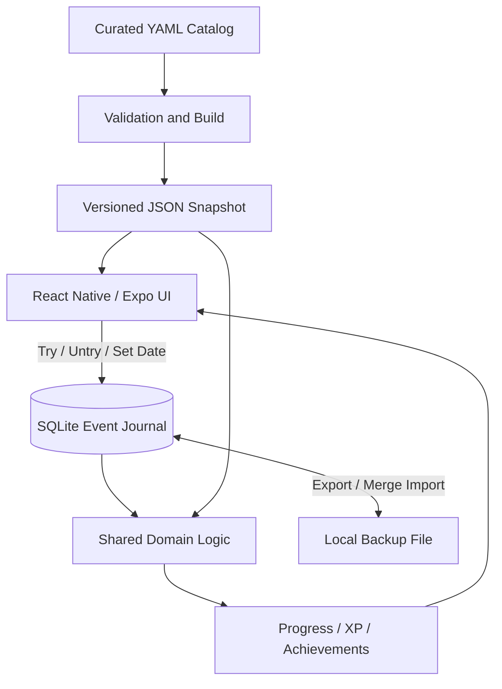

# Vkusodex — Product Architecture

## Overview

Vkusodex is an offline-first mobile application built with React Native, Expo, and TypeScript.

Its architecture separates product presentation, local persistence, catalog data, and domain logic.

The current implementation does not require a backend for the core collection experience.

## 1. Product Data Flow

This diagram represents the current local-first architecture.

It intentionally excludes planned backend services, accounts, and cloud synchronization.

## 2. Application Structure

The project uses npm workspaces to separate responsibilities.

| Component | Responsibility |
|---|---|
| Mobile App | Screens, interactions, and platform integrations |
| Catalog | Curated content, validation, and snapshot generation |
| Domain | Progress calculations, achievements, levels, and search |
| Schema | Typed data contracts and runtime validation |

React Native components consume domain-derived information rather than implementing core collection rules themselves.

## 3. Local-First Persistence

User activity is stored on-device using SQLite.

The local database contains an append-only event journal.

Core event types represent:

- Marking a product as tried
- Removing a tried mark
- Setting or clearing a tasting date

Events use unique identifiers and recorded timestamps.

The current state is reconstructed from recorded events rather than maintained as an independent mutable source of truth.

## 4. Derived Progress

Collection progress and achievements are calculated using shared TypeScript domain functions.

Derived values include:

- Tried products
- Completed collections
- Experience points
- Player levels
- Achievement progress

These values are derived from the catalog and the user's recorded activity.

This reduces duplication of business state and supports recalculation when rules evolve.

## 5. Catalog Pipeline

Curated catalog content is maintained as structured YAML data.

The catalog toolchain:

1. Validates source data and references.
2. Checks catalog consistency.
3. Generates a versioned JSON snapshot.
4. Makes the snapshot available to the mobile application.

The catalog builder is designed to produce deterministic output when its inputs are unchanged.

Schema validation uses Zod.

## 6. Backup and Restore

The application supports local export and import of user activity.

Backup files contain a versioned event-journal representation.

Import merges valid events with locally stored events, ignoring already-known event identifiers.

This approach allows users to restore activity without replacing their existing journal.

The current backup mechanism is local file import/export, not cloud synchronization.

## 7. Product Sharing

The application supports generating images of collections.

The sharing flow renders a collection card as an image and opens the platform's native share interface.

This functionality operates independently of a social backend.

## 8. Localization and UI

The application uses React Native and Expo Router for its interface and navigation.

Internationalization is implemented with i18next and react-i18next.

The current interface supports English and Russian, with light and dark appearance options.

## 9. Quality and Validation

The project uses Vitest for automated testing of domain and schema functionality.

A GitHub Actions workflow is configured to execute:

- TypeScript type checking
- Linting
- Automated tests
- Catalog validation

These checks help detect inconsistent data and regressions before changes are integrated.

## 10. Future Architecture

Future development may introduce:

- User accounts and authentication
- Backend APIs
- Cloud synchronization
- Social activity and friends
- Expanded catalog capabilities

These are planned extensions and should not be interpreted as currently implemented services.

## 11. Documentation Scope

This public architecture overview is intentionally simplified.

The production source code, internal development configuration, unpublished assets, and implementation-specific details are not included.

The focus is on architectural responsibilities, product data flow, and the engineering principles behind the application.
